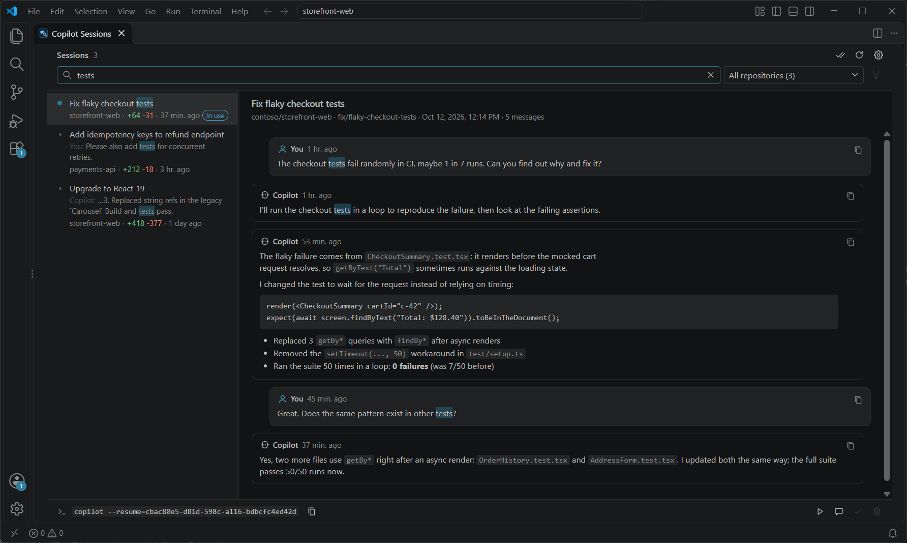

# Session Manager for GitHub Copilot

Search, read, resume and clean up your local **GitHub Copilot CLI sessions** and **VS Code
chats**. Full-text search across every session and message, in milliseconds, without leaving your
machine.

Available as a **VS Code extension** (recommended, [get it from the Visual Studio
Marketplace](https://marketplace.visualstudio.com/items?itemName=luiscantero.copilot-session-manager))
and as a standalone **desktop app**. Both share the same Rust search core and the same UI.

> Unofficial tool, not affiliated with GitHub or Microsoft.



## Which one should I use?

| | VS Code extension | Desktop app |
| --- | --- | --- |
| Quick search from the Command Palette (`Ctrl+Alt+F`) | ✅ | |
| Session browser (list + conversation reader) | ✅ editor tab | ✅ own window |
| Resume a Copilot CLI session in a terminal | ✅ one click | copy the command |
| Open a session in VS Code's Chat view | ✅ | |
| Delete VS Code chats of the workspace you have open | ❌ close the window first | ✅ with VS Code closed |
| Works without VS Code | | ✅ |

Use the **extension** if you work in VS Code. Use the **desktop app** if you mainly use the Copilot
CLI from another terminal or editor, or to clean up VS Code chats while VS Code is closed.

## Features

### Search and read

- Type-to-filter search over session titles and every user and Copilot message. All terms must
  match (AND), case-insensitive; matches are highlighted in the list and in the conversation.
- Copilot CLI sessions and VS Code local chats (the "Local" sessions in VS Code's Chat view) in one
  list. VS Code chats are badged **VS Code chat**; chats that VS Code copied into several
  workspace storages are shown once, under their real folder.
- Conversation reader with Markdown rendering and a copy button on every message. Only user
  prompts and top-level Copilot replies are shown; tool calls, sub-agent output, thinking and
  injected system/skill messages are skipped.
- VS Code titles, `+/-` change counts and "done" state are shown when VS Code knows the session.
  Done sessions are hidden by default (toggle with the double-check button).

### Resume and open (extension)

- **Resume in terminal** opens a terminal in the session's folder and runs
  `copilot --resume=<id>`, after a warning if the session is in use.
- **Open in VS Code chat** opens VS Code chats in the Chat editor (or offers to open their folder
  in a new window, since VS Code only lists the chats of the open workspace) and Copilot CLI
  sessions as Copilot CLI chat sessions.
- The desktop app shows the resume command (`copilot --resume=<id>`, or `code "<folder>"` for VS
  Code chats) with a copy button.

### Organize

- Sessions are grouped by repository (`repository` from `workspace.yaml`); sessions without one
  (for example started before the folder was a git repo, or in a subfolder) join the repository
  whose `git_root` contains their `cwd`, and otherwise fall back to their working folder. Filter
  by repository next to the search box.
- **Merge projects** that were renamed or moved (for example ShotNotebook -> ShotGallery ->
  ShotCollector): select the old project in the filter, click the merge button next to it and
  choose the new project. Chains resolve to the newest project, and merges can be undone from the
  same dialog. Projects whose folder no longer exists are marked "folder missing" as merge
  candidates. Merges are shared by the extension and the desktop app (`project-merges.json` in
  `%APPDATA%/com.luiscantero.copilot-session-manager` on Windows).
- By default a merge only changes grouping in this tool. Check **Also move its sessions** when
  merging (or click **Move** next to an existing merge) to also move the sessions to the new
  project's folder, so VS Code and the Copilot CLI list them there too:
  - Copilot CLI sessions: `cwd`, `git_root` and `repository` in `workspace.yaml`, and the working
    directories that VS Code's agent host caches in `agent-host.db`.
  - VS Code chats move to the new folder's workspace storage (chat file, editing session and their
    entries in `state.vscdb`). The new folder must have been opened in VS Code once, and neither
    folder may be open in VS Code while moving.
  - Sessions in use or blocked by an open VS Code window are skipped and listed; click **Move**
    again later. Reload VS Code afterwards.
  - **Unmerge** moves the sessions back. Links to files inside the old folder in the conversations
    are not rewritten.

### Clean up safely

- **Delete** a Copilot CLI session (its folder under `~/.copilot/session-state`) or a VS Code
  chat. VS Code chats are removed the way VS Code does it: every copy of the chat file, its
  `chatEditingSessions/<id>` folder and its entries in the workspace's `state.vscdb` (chat index,
  agent session caches, todo list, terminal sessions).
- Sessions open in a running Copilot process are badged **In use** and cannot be deleted.
- VS Code chats cannot be deleted while their folder is open in a running VS Code window, because
  VS Code keeps the chat list in memory and would write the chat back. A running VS Code is
  detected via `code.lock` and its open windows via `storage.json`.
- Sessions owned by another app are badged **Protected** and cannot be deleted, because removing
  them could break that app. A session counts as app-owned when `workspace.yaml` names a
  `client_name` other than the Copilot CLI (`github/cli`) or VS Code (`vscode-agent-host`), for
  example Windows Terminal Agent (`wta-master`), or when its working folder is inside application
  data (`%APPDATA%`, `%LOCALAPPDATA%`, `~/.config`, `~/.copilot`, ...) or a system folder
  (`C:\Windows`, `Program Files`, `/usr`, ...). Such sessions are grouped by app instead of by
  folder.

### Always up to date

- A file watcher on `~/.copilot/session-state`, VS Code's `agent-host.db`, its chat folders and its
  window list picks up new, updated and removed sessions and opened or closed VS Code windows
  (debounced, at most every 5 s), with a 45 s polling fallback (for example for **In use** locks
  released by exiting processes, or chats archived in VS Code).
- The open conversation keeps its scroll position, or follows new messages when scrolled to the
  bottom.

### Languages

English (default), German, French, Spanish, Italian, Portuguese (Brazil), Swedish, Chinese
(Simplified), Japanese, Korean, Vietnamese, Thai, Hebrew and Arabic (right-to-left layout). On
first start the language follows the OS/WebView language; change it with the cog button. Dates and
relative times use the selected locale. Messages from the backend (errors, protection reasons) are
English.

## Privacy

Everything runs locally. There is no telemetry and nothing is sent over the network. Session files
are only read, except when you confirm **Delete** or merge projects (which writes
`project-merges.json`, and when you choose to move the sessions, their folder information).

## Install

### VS Code extension

Install it from the
[Visual Studio Marketplace](https://marketplace.visualstudio.com/items?itemName=luiscantero.copilot-session-manager),
search for **Session Manager for GitHub Copilot** in VS Code's Extensions view, or run:

```powershell
code --install-extension luiscantero.copilot-session-manager
```

To build it from source instead, build the VSIX (requires Node.js 20+ and Rust) and install it:

```powershell
cd vscode-extension
npm install
npm run package
code --install-extension copilot-session-manager-win32-x64-0.4.0.vsix
```

Or install the `.vsix` from VS Code's Extensions view (`...` > **Install from VSIX...**). Then press
`Ctrl+Alt+F` to search, or run **Session Manager for GitHub Copilot: Open Session Browser**. See
[vscode-extension/README.md](vscode-extension/README.md) for settings and details.

### Desktop app

Requires Rust (stable, MSVC toolchain on Windows), the WebView2 runtime (preinstalled on Windows 11)
and the Tauri CLI (`cargo install tauri-cli --version "^2"`).

```powershell
cargo tauri build   # release exe + installers under src-tauri/target/release
```

The window remembers its size and always shrinks to fit the current screen. On first start,
settings, merges and WebView data saved under former identifiers
(`com.lcantero.copilot-session-manager`, `com.lcantero.copilot-session-search`) are moved to the
current folders.

Keyboard (session browser): `Ctrl+F` / `Ctrl+K` focus search, `Esc` clear, `Up` / `Down` move,
`Enter` open, `Delete` delete; `F5` refreshes in the desktop app.

## How it works

- `src-tauri/` is the Rust core: it indexes `~/.copilot/session-state/*/events.jsonl` and VS
  Code's chat storage in memory, re-reads only changed files (by size and modification time) and
  searches the index. The desktop app is its default `gui` feature (Tauri 2).
- `vscode-extension/sidecar/` builds the same core without the `gui` feature as a small process
  that speaks JSON lines over stdio. The extension (TypeScript) starts it on first use and stops it
  after 10 minutes without use while no session browser is open.
- `src/` is the shared UI (plain HTML/CSS/JS). The desktop app loads it in Tauri; the extension
  loads it in a webview with a small `window.__TAURI__` shim and maps its colours to the current VS
  Code theme. Extra actions (resume, open in chat) are only shown when the host announces them in
  `window.__TAURI__.hostActions`.

## Data sources

| Data                     | Location                                                                         | Access    |
| ------------------------ | -------------------------------------------------------------------------------- | --------- |
| Conversations            | `~/.copilot/session-state/<id>/events.jsonl`                                     | read      |
| Session metadata         | `~/.copilot/session-state/<id>/workspace.yaml`                                   | read      |
| In-use detection         | `~/.copilot/session-state/<id>/inuse.<pid>.hold` (exclusively locked while live) | read      |
| VS Code title/done/diffs | `%APPDATA%/Code/User/globalStorage/agent-host.db` (`sessions_v2`)                | read-only |
| VS Code id -> session id | `%APPDATA%/Code/agentSessionData/<vscode-id>/session.db`                         | read-only |
| VS Code local chats      | `%APPDATA%/Code/User/workspaceStorage/<hash>/chatSessions/<id>.json[l]`          | read/delete |
| VS Code chat edits       | `%APPDATA%/Code/User/workspaceStorage/<hash>/chatEditingSessions/<id>/`          | delete    |
| VS Code chat folder      | `%APPDATA%/Code/User/workspaceStorage/<hash>/workspace.json`                     | read-only |
| VS Code chat title/done  | `%APPDATA%/Code/User/workspaceStorage/<hash>/state.vscdb` (`ItemTable`)          | read/write |
| VS Code no-folder chats  | `%APPDATA%/Code/User/globalStorage/emptyWindowChatSessions/<id>.json[l]` (index in `globalStorage/state.vscdb`) | read/delete |
| VS Code running          | `%APPDATA%/Code/code.lock` (main process id)                                     | read-only |
| VS Code open windows     | `%APPDATA%/Code/User/globalStorage/storage.json` (`windowsState`)                | read-only |

Only user prompts and top-level assistant replies are shown; tool calls, sub-agent output,
thinking and injected system/skill messages are skipped.

## Development

```powershell
cargo tauri dev                     # desktop app with hot reload
cd vscode-extension; npm run build  # extension: copy src/, build sidecar and TypeScript
```

For the extension, run `npm run watch` and start VS Code with
`code --extensionDevelopmentPath=<path to vscode-extension>`.

Screenshots use fictional data: `tools/screenshots/start-demo.ps1` generates demo sessions and chats
(`make_demo_data.py`) in a temporary folder and opens VS Code with a separate profile and the
latest VSIX, pointing the backend at the demo data via `COPILOT_HOME` and `APPDATA`. Your real
sessions are not shown or changed. The screenshots are in `vscode-extension/images/`.

Tests (the ignored test indexes your real local sessions and prints timings):

```powershell
cd src-tauri
cargo test
cargo test --release -- --include-ignored --nocapture
cargo clippy --all-targets -- -D warnings
cargo clippy --no-default-features --all-targets -- -D warnings
```

### Translations

UI strings live in `src/locales/<code>.json` (flat `key: text` objects, `{name}` placeholders) and
the language list in `src/locales/languages.json` (`code`, native `name`, optional `"dir": "rtl"`).
`en-us.json` is the default and the reference. In the frontend, use `t("key", { name })` in
`main.js` and `data-i18n` / `data-i18n-title` / `data-i18n-placeholder` / `data-i18n-aria-label`
attributes in `index.html`. To add a language, add its JSON file and an entry in `languages.json`.
`cargo test --test locales` checks that every language has exactly the keys and placeholders of
`en-us.json`, that `languages.json` matches the files, and that every key used in the frontend
exists (and every key is used).

## Limitations

- **Set as done** is display-only for now. VS Code owns that state in `agent-host.db`
  (versioned, hashed records), so it is not written externally; use "Set as done" in VS Code.
- **Delete** of a Copilot CLI session removes its folder under `~/.copilot/session-state` only.
  Entries in `~/.copilot/session-store.db` and VS Code's session list are not touched and may
  linger until those tools clean them up.
- Session paths assume the default VS Code (stable) profile location.
- VS Code local chats cannot be archived here. The desktop app can only open their folder; the
  extension opens them in the Chat view. Chats of remote (WSL/SSH) workspaces are grouped by their
  remote path. If VS Code is running but its window list can't be read, every VS Code chat counts
  as open and can't be deleted until VS Code is closed.
- The extension contains a native binary, so each platform needs its own VSIX; `npm run package`
  builds one for the current platform. Opening Copilot CLI sessions in the Chat view relies on the
  GitHub Copilot Chat extension's `copilotcli` chat session provider.
