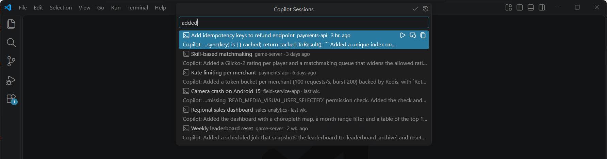

# Session Manager for GitHub Copilot

**Search, resume and clean up your GitHub Copilot CLI sessions and VS Code chats.** Full-text
search across every session and message on your machine, in milliseconds.

> Unofficial extension, not affiliated with GitHub or Microsoft.

## Why

Copilot CLI sessions pile up in `~/.copilot/session-state`, and VS Code keeps chats per workspace,
so finding "that conversation where we fixed the build" means guessing the folder and scrolling.
This extension puts all of them in one searchable list, wherever they were started:

- **Copilot CLI first**: resume any CLI session in a terminal with one click, see which sessions
  are in use by a running Copilot process, and open CLI sessions in VS Code's Chat view.
- **VS Code chats from every workspace**, not only the one you have open.
- **Clean up safely**: delete old sessions and chats, with guards for sessions that are in use,
  owned by other apps, or still open in a VS Code window.
- **Organized by repository**, with merging for repositories that were renamed or moved.




## Features

- **Quick search** (`Ctrl+Alt+F`, `Cmd+Alt+F` on macOS, or *Session Manager for GitHub Copilot:
  Search Sessions…*): type to search session titles and every user and Copilot message. All terms
  must match (case-insensitive). Results show the project, age, badges and the matching message.
  - `Enter` shows the conversation in the session browser (configurable, see below).
  - Item buttons: **Resume in terminal** (Copilot CLI sessions), **Open in VS Code chat** and
    **Copy resume command**.
  - Title buttons: show or hide sessions marked as done, and open the session browser.
- **Session browser** (*Session Manager for GitHub Copilot: Open Session Browser*): a session list
  and a conversation reader in an editor tab, themed like your editor, with highlighted matches, a
  repository filter, project merging, copy buttons and delete. It updates automatically while
  sessions change on disk. When it opens, the filter selects the project of the open folder, if it
  has sessions. Those sessions are listed first, while the others are indexed in the background.
- **Resume in terminal**: opens a terminal in the session's folder and runs
  `copilot --resume=<id>`. Asks first if the session is in use by another Copilot process.
- **Open in VS Code chat**:
  - VS Code chats open in the Chat editor when they belong to the current window's folder or
    workspace. Otherwise the extension offers to open their folder in a new window, where the chat
    is listed in the Chat view's history (VS Code only shows the chats of the open workspace).
  - Copilot CLI sessions open as Copilot CLI chat sessions (requires the GitHub Copilot Chat
    extension).
- **Delete**: removes Copilot CLI session folders, and VS Code chats the way VS Code does (chat
  file, editing session and their entries in the workspace database). Sessions in use, owned by
  other apps (for example Windows Terminal Agent), or whose VS Code window is open cannot be
  deleted.
- **Merge projects** of renamed or moved repositories. A merge groups the old project's sessions
  under the new one; optionally it also moves them to the new project's folder, so VS Code and
  the Copilot CLI list them there too (VS Code chats only while neither folder is open in VS
  Code). Unmerging moves them back.
- **14 UI languages** in the session browser, including right-to-left layouts.

## Privacy

Everything runs locally. There is no telemetry and nothing is sent over the network. Session files
are only read, except when you confirm **Delete** or merge projects and choose to move their
sessions.

## How it works

The extension starts a small native backend (`bin/copilot-session-manager-sidecar`, written in
Rust) on first use and talks to it with JSON lines over stdio. The backend keeps an in-memory index
of `~/.copilot/session-state/*/events.jsonl` and VS Code's chat storage. The first search indexes
everything (a few seconds for about a thousand sessions); after that, only changed files are read
again, and a file watcher reports changes. The backend stops after 10 minutes without use while no
session browser is open.

There is also a standalone [desktop app](https://github.com/luiscantero/CopilotSessionManager) with
the same features, for use without VS Code. Project merges are shared with it
(`project-merges.json` in `%APPDATA%/com.luiscantero.copilot-session-manager` on Windows).

## Settings

| Setting | Default | Description |
| --- | --- | --- |
| `copilotSessionManager.quickPick.defaultAction` | `showConversation` | What `Enter` does in the quick search: `showConversation`, `resume` or `openInChat`. |
| `copilotSessionManager.copilotCommand` | `copilot` | Command used to resume Copilot CLI sessions (`--resume=<id>` is appended). |
| `copilotSessionManager.sidecarPath` | | Path to a custom build of the backend. |

## Limitations

- *Set as done* is display-only: VS Code owns that state, so mark sessions as done in VS Code.
- Session paths assume the default VS Code (stable) profile.
- VS Code chats of the workspace you have open cannot be deleted, because VS Code would write
  them back; use the desktop app with VS Code closed.
- Opening Copilot CLI sessions in the Chat view relies on the GitHub Copilot Chat extension's
  `copilotcli` chat session provider.

## Install

Install the extension from the
[Visual Studio Marketplace](https://marketplace.visualstudio.com/items?itemName=luiscantero.copilot-session-manager),
search for **Session Manager for GitHub Copilot** in VS Code's Extensions view, or run:

```powershell
code --install-extension luiscantero.copilot-session-manager
```

## Build from source

Requirements: Node.js 20+, Rust (stable).

```powershell
cd vscode-extension
npm install
npm run package   # copies ../src, builds the sidecar and TypeScript, writes copilot-session-manager-<platform>-<version>.vsix
code --install-extension copilot-session-manager-win32-x64-0.4.0.vsix
```

The VSIX contains a native binary, so it is platform-specific. `npm run package` builds for the
current platform; to build for another one, set `SIDECAR_TARGET` (Rust target triple, for
`npm run build`) and `VSCE_TARGET` (for example `darwin-arm64`, for `node scripts/package.mjs`).
To package a backend built elsewhere, point `SIDECAR_BINARY` at it instead of `SIDECAR_TARGET`.

For Linux, build a static backend (no glibc version requirement) with
[cargo-zigbuild](https://github.com/rust-cross/cargo-zigbuild), for example in WSL, and package it
from Windows:

```powershell
wsl -e bash -lc "cd vscode-extension/sidecar && rustup target add x86_64-unknown-linux-musl && CARGO_TARGET_DIR=~/.cache/csm-sidecar cargo zigbuild --release --locked --target x86_64-unknown-linux-musl"
$env:SIDECAR_BINARY = "\\wsl.localhost\Ubuntu\home\<user>\.cache\csm-sidecar\x86_64-unknown-linux-musl\release\copilot-session-manager-sidecar"
$env:VSCE_TARGET = "linux-x64"
npm run package
```

On Linux and macOS the extension sets the backend's executable bit on first use, since a VSIX
packaged on Windows does not keep it.

For development, run `npm run build` once, then `npm run watch`, and start VS Code with
`code --extensionDevelopmentPath=<this folder>`.
The UI files in `media/app` are copied from `../src` by `npm run build:assets`.

## Feedback

Report issues and ideas at
[github.com/luiscantero/CopilotSessionManager/issues](https://github.com/luiscantero/CopilotSessionManager/issues).
